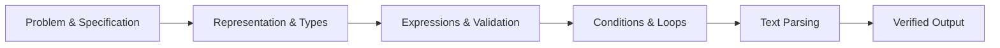
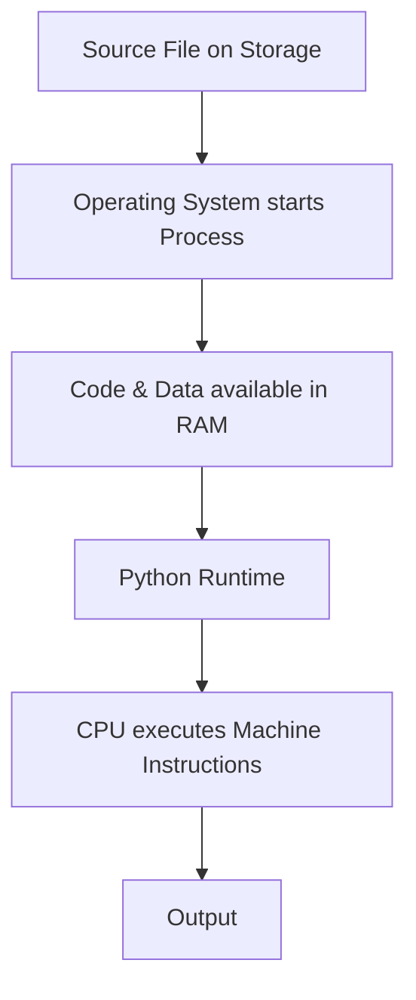
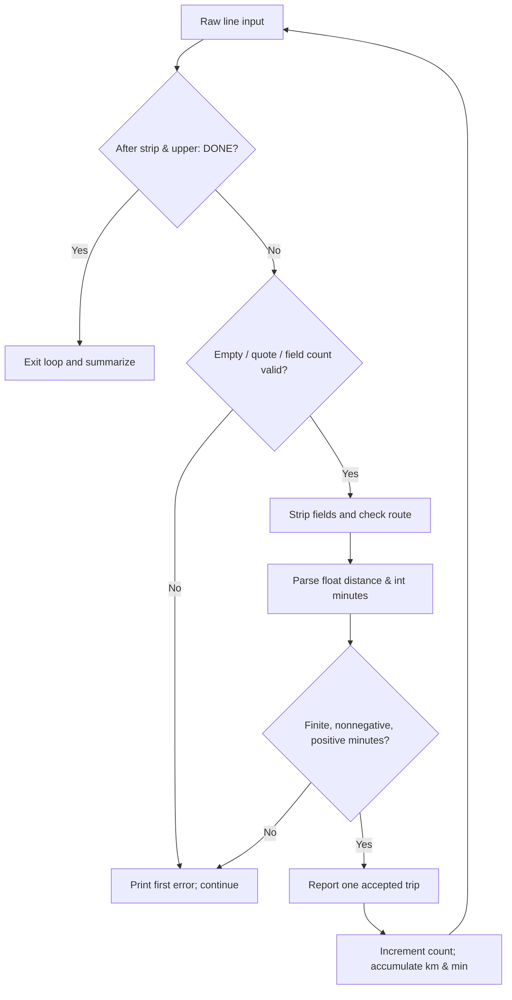

# Computer Programming 期中完整複習：從電腦架構到 Python 文字解析

> **適用範圍：** Computer Programming Deck 1–5（含各 Deck 中文補充講義）  
> **閱讀方式：** 概念 → 範例 → 常見陷阱 → 考前速查  
> **範圍聲明：** 本文依講義整理，不代表教師已公告所有內容皆為必考；標記「延伸／選讀」的內容不視為核心專題要求。

這份筆記不打算把 Python 語法從頭抄一遍，而是將五份教材串成一條可理解的主線：**問題如何被表示、程式如何被執行、資料如何被判斷與重複處理，以及文字如何被解析成可信的資料。**

## 目錄

- [1. 課程總覽：五個 Deck 在學什麼](#1-課程總覽五個-deck-在學什麼)
- [2. Deck 1：電腦與程式執行模型](#2-deck-1電腦與程式執行模型)
- [3. Deck 2：資料型態、運算與二進位表示](#3-deck-2資料型態運算與二進位表示)
- [4. Deck 3：條件判斷與資料驗證](#4-deck-3條件判斷與資料驗證)
- [5. Deck 4：迴圈、累加器與記憶體區域性](#5-deck-4迴圈累加器與記憶體區域性)
- [6. Deck 5：字串、解析與文字編碼](#6-deck-5字串解析與文字編碼)
- [7. 跨章整合：Trip Summary 到 Trip Text](#7-跨章整合trip-summary-到-trip-text)
- [8. 常見錯誤與除錯](#8-常見錯誤與除錯)
- [9. 考前速查表](#9-考前速查表)
- [10. 最後複習策略](#10-最後複習策略)

---

## 1. 課程總覽：五個 Deck 在學什麼

| Deck | 主題 | 核心問題 |
|---|---|---|
| **1** | Programming Fundamentals | 如何把問題變成可執行、可驗證的程式？ |
| **2** | Values, Types & Expressions | 電腦如何表示數值？型態如何影響運算？ |
| **3** | Conditions & Decisions | 如何將規格轉成判斷與拒絕規則？ |
| **4** | Loops & Sessions | 如何處理多筆資料，正確停止及統計？ |
| **5** | Strings & Text Processing | 如何將一行文字安全地解析成資料？ |



**核心原則：**程式能執行，不等於程式符合規格。永遠先確認 *Input / Process / Output*，再獨立計算預期結果（Expected Output）。

---

## 2. Deck 1：電腦與程式執行模型

### 2.1 Input → Process → Output

所有小程式都能先問三件事：

1. **Input：**資料來自哪裡？例如鍵盤、檔案、感測器、網路。
2. **Process：**要執行什麼計算、轉換或決策？
3. **Output：**應產生什麼文字、檔案、畫面或網路回應？

攝氏轉華氏的模型：

\[
F=C\times\frac95+32
\]

例如輸入 `C = 0`，在寫程式前就應知道預期值為 `32`。

### 2.2 Hardware 與 Software

| 元件 | 英文 | 角色 |
|---|---|---|
| 中央處理器 | CPU | 執行 Machine Instructions，進行運算及控制流程 |
| 主記憶體 | RAM | 保存執行中程式需要的資料與狀態 |
| 持久儲存 | SSD / HDD | 在關機及程式結束後保留檔案 |
| 作業系統 | Operating System | 管理資源、建立執行環境與 Process |
| 程式與工具 | Software | 指示電腦執行工作，如 Python、VS Code、自己的程式 |

簡化的執行模型：



> **注意：**這是一個教學模型，不代表所有資料一定按單向順序搬運。真實系統還有 Cache、Virtual Memory、I/O Controller、DMA 等機制。SSD 可以透過 I/O 被 CPU 控制，但通常不是一般 `LOAD / STORE` 指令直接使用的主記憶體。

### 2.3 Fetch → Decode → Execute

CPU 的入門工作模型：

- **Fetch：**取得下一條機器指令。
- **Decode：**解讀操作、暫存器與運算元。
- **Execute：**執行運算，更新暫存器、記憶體或控制流程。

**一行 Python 不等於一條 CPU 指令。** `print(3 + 5)` 會涉及 Python Runtime 的多個底層步驟。

### 2.4 程式語言層次

| 層次 | 說明 |
|---|---|
| **High-level Language** | Python、C、Java 等，較接近人的問題描述 |
| **Assembly Language** | `MOV`、`ADD` 等指令助記符，與 CPU 架構密切相關 |
| **Machine Language** | CPU 實際解碼的指令位元編碼 |

不同 ISA（Instruction Set Architecture），如 x86、ARM、RISC-V，具有不同的機器指令編碼。

**Compiler / Interpreter 並非絕對二選一：**

- **Compilation：**將一種程式表示轉換成另一種表示，可能生成 Bytecode，也可能生成 Machine Code。
- **Interpretation：**由某個程式或 Runtime 解讀、執行一種程式表示。
- **CPython 教學模型：** `Source → Parse / Compile → Bytecode → Runtime`。Bytecode 並不是 CPU 的原生 Machine Code。

**Interactive / Script Mode：**

```python
# 在互動式 REPL 中輸入 3 + 5，會顯示 8。
# 但把 3 + 5 單獨放在 .py 檔案通常不會自動輸出。
print(3 + 5)  # 8
```

### 2.5 Algorithm、Testing、Version Control

- **Algorithm：**解決問題的一系列明確步驟。
- **Pseudocode：**先表達解法流程，不受特定語言語法干擾。
- **Test Case：**指定輸入，加上獨立推導的預期結果。
- **Debugging：**讀取錯誤、定位位置、提出原因假設、修正並重新測試。

開發流程可視為：`Understand → Design → Write / Generate → Run → Debug → Verify`。

Git 與 GitHub 不相等：

| 動作／工具 | 實際功能 |
|---|---|
| **Save** | 把編輯器內容寫回本機檔案 |
| **Commit** | 建立本機 Git 歷史中的版本紀錄 |
| **Push** | 將本機 Commits 送到遠端 |
| **Git** | 版本控制系統 |
| **GitHub** | Git Repository 的代管與協作服務 |

記住：**Save ≠ Commit ≠ Push**。不要把 Password、API Key、Token 等秘密資料提交進 Repository；`.gitignore` 不能自動抹去已進入 Git History 的秘密。

---

## 3. Deck 2：資料型態、運算與二進位表示

### 3.1 Value、Type 與 Name Binding

```python
print(65 + 1)         # 66
print(65.0 + 1)       # 66.0
print("65" + "1")     # 651
# print("65" + 1)     # TypeError
```

| Type | 例子 | 意義 |
|---|---|---|
| `int` | `65` | 整數 |
| `float` | `65.0` | 浮點數 |
| `str` | `"65"` | 文字 |
| `bool` | `True`、`False` | 布林值 |

Python 的指派是**名稱綁定**，不是數學等式，也不是自動更新的連結：

```python
a = 10
b = a
a = 20
print(a, b)  # 20 10
```

大寫常數如 `MILES_PER_KM` 是**命名慣例**，不是 Python 禁止重新指派的機制。變數名稱區分大小寫，常見風格為 `snake_case`。

### 3.2 `input()` 與型態轉換

`input()` 回傳 `str`；按下 Enter 結束輸入，但回傳字串不含結尾換行。

```python
# 假設分別輸入 3、5
a = input("a: ")
b = input("b: ")
print(a + b)  # 35
```

| Expression | Result |
|---|---|
| `int("007")` | `7`，前導零不再保留 |
| `float("12.5")` | `12.5` |
| `int(12.9)` | `12`，向零截斷 |
| `int(-12.9)` | `-12` |
| `int("12.5")` | `ValueError` |
| `str(12.5)` | `"12.5"` |

**型態轉換與資料驗證是兩件事。** `int("0")` 可以成功，但 Deck 2／3 的「正整數分鐘」仍不接受 0。

### 3.3 運算子與精確性

| Operator | 功能 | 範例 |
|---|---|---|
| `/` | True Division | `45 / 60 → 0.75` |
| `//` | Floor Division | `83 // 60 → 1` |
| `%` | Remainder | `83 % 60 → 23` |
| `**` | Exponentiation | `3 ** 2 → 9` |
| `^` | Bitwise XOR，**不是次方** | `6 ^ 3 → 5` |

負數更要注意：

```python
print(-11 // 4)     # -3，向負無窮大取整
print(-11 % 4)      # 1
print(int(-11 / 4)) # -2，向零截斷
```

對應的關係是：`a == (a // b) * b + (a % b)`（`b != 0`）。

運算結合方向也重要：

```python
print(2 ** 3 ** 2)  # 512，等於 2 ** (3 ** 2)
print(-3 ** 2)      # -9
print((-3) ** 2)    # 9
```

**單位比輸出標籤重要：**

\[
\mathrm{speed_{km/h}}=\frac{\mathrm{distance_{km}}}{\mathrm{duration_{min}}/60}
\]

不可寫成 `distance_km / duration_min / 60`，因為連續除法從左向右求值，算出的不是 km/h。

**浮點數與顯示格式：**

```python
a = 0.1 + 0.2
print(a)           # 0.30000000000000004
print(f"{a:.2f}") # 0.30
```

`:.2f` 讓輸出顯示兩位小數，**不會修改原本的浮點值**；f-string 的結果本身是 `str`。`0.5` 等二進位可精確表示的數則不會有同樣的近似問題。

### 3.4 Bit、Byte、Unsigned

- `1 byte = 8 bits`。
- `n bits` 共有 `2^n` 種位元圖樣。
- **Unsigned Range：**

\[
0\le x\le 2^n-1
\]

| Width | Patterns | Unsigned Range |
|---|---:|---|
| 8-bit | 256 | 0～255 |
| 16-bit | 65,536 | 0～65,535 |

例如 `00001101₂ = 8 + 4 + 1 = 13₁₀`。

### 3.5 Two's Complement（二補數）

n-bit Two's Complement 的範圍：

\[
-2^{n-1}\le x\le 2^{n-1}-1
\]

| Width | Signed Range |
|---|---|
| 8-bit | -128～127 |
| 16-bit | -32,768～32,767 |

用 8-bit 表示 -5：

```text
+5:    00000101
Invert:11111010
+1:    11111011
```

同一組 `11111011`：

- 以 **Unsigned** 解讀為 `251`。
- 以 **8-bit Two's Complement** 解讀為 `-5`。

**重點：bit pattern 的意義取決於位元寬度與 Interpretation Rule。** Python 一般 `int` 是受資源限制的任意精度整數，不會因為 `127 + 1` 超過 8-bit Signed 範圍，就自動變成 -128。

---

## 4. Deck 3：條件判斷與資料驗證

### 4.1 Comparison Operators

| Operator | 意義 |
|---|---|
| `>`、`>=` | 大於、大於等於 |
| `<`、`<=` | 小於、小於等於 |
| `==` | 值相等 |
| `!=` | 值不相等 |

```python
print("30" == 30)  # False
print("9" > "30")  # True，字串順序不是數值大小
# print("30" > 0)  # TypeError
```

### 4.2 Logical Operators 與 Short-circuit

| A | B | A and B | A or B |
|---|---|---|---|
| True | True | True | True |
| True | False | False | True |
| False | True | False | True |
| False | False | False | False |

**優先順序：** `not > and > or`（比較運算子又高於這三者）。

- `and` 左側為假，右側不會求值。
- `or` 左側為真，右側不會求值。

```python
duration_min = 0
safe = (duration_min > 0) and (60 / duration_min > 10)
print(safe)  # False，未執行除以零
```

但 `and / or` **不一定回傳 bool**：

```python
print(False or 60)  # 60
print(5 or 60)      # 5
print(0 and 60)     # 0
```

以下不是「等於 30 或等於 60」的正確縮寫：

```python
duration_min = 45
print(duration_min == 30 or 60)  # 60
```

正確是：

```python
print(duration_min == 30 or duration_min == 60)  # False
```

### 4.3 `if`、`elif`、`else` 和縮排

```python
duration_min = 45
if duration_min <= 30:
    print("Short")
elif duration_min <= 60:
    print("Medium")
else:
    print("Long")
# Medium
```

Deck 3 行程時間分類的**前提是時間已通過正整數驗證**：

| Band | Minutes |
|---|---|
| Short | `0 < t <= 30` |
| Medium | `30 < t <= 60` |
| Long | `t > 60` |

一串 `if/elif/else` 只會選到第一個成立的分支；兩個獨立 `if` 則可能都執行。

**印出 Error 並不會停止程式**：

```python
duration_min = 0
if duration_min <= 0:
    print("Error")
# 此行在 if 區塊外，仍會執行：
speed = 60 / duration_min  # ZeroDivisionError
```

應把計算放在 `else` 中，或透過其他正確的控制流程隔離無效資料。

### 4.4 Validation Order 與非有限數

Deck 3 v0.3 的規則：

1. 標籤 `""` 無效；其他文字保留原樣。
2. 距離必須是 **Finite（有限）且 Non-negative（非負）**，零有效。
3. 時間必須是正整數分鐘。
4. 無效資料只顯示**第一個錯誤**，不執行後續計算。

```python
import math
print(math.isfinite(12.5))         # True
print(math.isfinite(float("inf"))) # False
print(math.isfinite(float("nan"))) # False
```

只檢查 `distance_km < 0` 無法完整排除 `nan` 或 `inf`。完整距離驗證應包括 `math.isfinite(distance_km)`。

---

## 5. Deck 4：迴圈、累加器與記憶體區域性

### 5.1 `for`、`range` 與 `while`

```python
for i in range(1, 4):
    print(i)
# 1, 2, 3（各佔一行）
```

| Expression | Sequence |
|---|---|
| `range(4)` | 0, 1, 2, 3 |
| `range(1, 4)` | 1, 2, 3 |
| `range(6, 0, -2)` | 6, 4, 2 |
| `range(8, 3)` | 空序列 |
| `range(0, 5, 0)` | `ValueError` |

`range(start, stop, step)` **包含起點，不包含終點**。`for` 的本質是從 Iterable 逐項取得元素；並非只能用在已知次數的工作。

```python
remaining = 3
while remaining > 0:
    print(remaining)
    remaining -= 1
# 3, 2, 1（各佔一行）
```

`while` 每輪重新檢查條件。若所有執行路徑都無法推進狀態，便可能陷入無窮迴圈。

### 5.2 `break`、`continue`、Nested Loops

- **`break`：**離開最內層迴圈。
- **`continue`：**跳過本輪後續程式，繼續下一輪。
- **Nested Loops：**每當外層進入新一次迭代，內層會重新開始。

```python
for i in range(1, 4):
    if i == 2:
        continue
    print(i)
# 1、3（各佔一行）
```

**警告：**若在 `while` 中的 `continue` 跳過了 `i += 1`，可能讓 `i` 永遠停在同一個值。

### 5.3 Counter、Accumulator 與 Loop Invariant

| 狀態 | 初始值 | 接受有效資料後 |
|---|---:|---|
| `accepted_count` | 0 | `+= 1` |
| `total_km` | 0.0 | `+= distance_km` |
| `total_min` | 0 | `+= duration_min` |

```python
total = 0
for i in range(1, 5):
    total += i
print(total)  # 10
```

**不能把 `total = 0` 放在迴圈內**，否則每輪清零後，最後只剩 4。Loop Invariant（迴圈不變量）的直覺是：每輪結束，`total` 都等於目前已接受資料的總和。

同樣地：**迭代次數 ≠ 有效資料筆數**。被拒絕的一筆資料雖然使用一次 Iteration，但不能增加 `accepted_count`。

### 5.4 Sentinel：`DONE`

Deck 4 v0.4：

```python
while True:
    route_name = input("Route label: ")
    if route_name == "DONE":
        break
    # 只有非 DONE 才繼續讀 km 和 minutes
```

在 Deck 4，只有**精確相同的大寫 `DONE`** 是結束命令，`done` 不等價。DONE 不是零距離行程，也不計入統計。

### 5.5 Overall Speed（整段平均速度）

接受 `12.5 km / 45 min` 與 `3.5 km / 30 min`：

\[
\mathrm{total\ distance}=12.5+3.5=16\ km
\]

\[
\mathrm{total\ duration}=45+30=75\ min=1.25\ h
\]

\[
\boxed{\mathrm{overall\ speed}=16/1.25=12.8\ km/h}
\]

不能把兩趟各自的平均速度直接做**等權算術平均**，因為兩趟經過時間不相同；同時，應保留原始總距離與總時間，最後才格式化顯示。

若 `accepted_count == 0`，不能拿零筆數計算平均；應輸出「沒有有效行程可摘要」的訊息。

### 5.6 CPU Branching 與 Locality

Deck 4 的教學指令模型：

```asm
LOAD R0, 0
loop: CMP R0, 3
      JGE done
      OUT R0
      ADD R0, 1
      JMP loop
done: HALT
```

- `CMP`：比較。
- `JGE`：條件符合「大於或等於」時跳躍。
- `JMP`：無條件跳躍。
- `ADD`：更新狀態。
- `HALT`：停止。

這是用來理解 Backward Jump 與重複執行的**教學指令集**，不是 Python 實際編譯出的機器碼。

**Memory Hierarchy：** CPU Cache、RAM、持久儲存扮演不同角色。Cache Hit 表示該層已有所需資料；Cache Miss 表示須往其他層級尋找。

| Locality | 中文 | 直覺 |
|---|---|---|
| Temporal Locality | 時間區域性 | 不久又存取同一位置 |
| Spatial Locality | 空間區域性 | 接著存取鄰近位置 |

簡化 Cache 題：初始空、Cache Line 涵蓋位址 `0–3`、不淘汰；依序存取 `0, 1, 2, 0`，答案是 **Miss、Hit、Hit、Hit**。

**延伸／選讀：**Deck 4 另有 `for...else`、`try/except` 解析恢復、Longest Trip 與測試證據的說明；這些不是核心行程協定原本已具有的能力。

---

## 6. Deck 5：字串、解析與文字編碼

### 6.1 字串是 `str`，而且 Immutable

```python
s = "Campus"
t = s
s = "Station"
print(s)  # Station
print(t)  # Campus
```

重新指派 `s` 不是原地修改舊字串。`s[0] = "c"` 會產生 `TypeError`。

跳脫字元 `\n` 是換行、`\t` 是 Tab；`repr()` 可以幫助檢查隱藏字元與兩端空白。`len()` 對 Python 字串計算 Unicode 碼位數，不必然等於人眼所見的字數。

### 6.2 Indexing 與 Slicing

`s = "Campus"`：

| Expression | Result |
|---|---|
| `s[0]` | `"C"` |
| `s[-1]` | `"s"` |
| `s[1:4]` | `"amp"` |
| `s[:3]` | `"Cam"` |
| `s[3:]` | `"pus"` |
| `s[-3:]` | `"pus"` |
| `s[::2]` | `"Cmu"` |
| `s[::-1]` | `"supmaC"` |
| `s[1:100]` | `"ampus"` |

**索引超出範圍**如 `s[100]` 會 `IndexError`；**切片超出範圍**則會在有效範圍截取。切片同樣是 **包含 start、不包含 stop**。

### 6.3 查找、清理與替換

| Method / Operation | 回傳／效果 |
|---|---|
| `x in s` | `bool`，是否包含子字串 |
| `s.find(x)` | 第一個位置；找不到回傳 `-1` |
| `s.startswith(x)` | `bool` |
| `s.count(x)` | 不重疊的出現次數 |
| `s.strip()` | 去除兩端空白，回傳新字串 |
| `s.lower()` / `s.upper()` | 回傳新字串 |
| `s.replace(a, b)` | 回傳替換後的新字串 |
| `s.split(",")` | 回傳 `list[str]` |

**容易寫反的陷阱：**

```python
label = "Campus East"
print(label.find("Campus")) # 0，代表找到開頭
print(label.find("West"))   # -1，代表找不到
```

不要用 `if label.find("Campus"):` 判斷存在：0 的 Truth Value 是假，-1 反而是真。問存在就用 `"Campus" in label`。

`strip()` 不會刪除內部空白；`replace(" ", "")` 卻會。Deck 5 要保留 `Campus East` 中間的空白及名稱大小寫。`replace()` 的回傳值若未重新指派，原字串不會改變。

### 6.4 `split()`、List 與 Parse

```python
line = "Campus East, 12.5, 45"
fields = line.split(",")
print(fields)
# ['Campus East', ' 12.5', ' 45']
```

`split(",")` 回傳的 List 內仍都是**字串**，且空白尚未自動清除。`line[0]` 是第一個字元，`fields[0]` 才是第一個欄位。

先檢查欄位數，才可以存取 `fields[2]`：

```python
fields = line.split(",")
if len(fields) != 3:
    print("Error: expected route, km, minutes.")
else:
    route_name = fields[0].strip()
    distance_text = fields[1].strip()
    duration_text = fields[2].strip()
```

**Deck 5 v0.5 的文字協定：**

- 每筆資料恰好三欄：`route, km, minutes`。
- 去除每欄位兩端空白，保留名稱的內部空白與大小寫。
- **整行**去除兩端空白後，忽略大小寫等於 `DONE` 才停止。
- 拒絕空行、雙引號與欄位數錯誤；本版本**不是完整 CSV Parser**。
- 保留 Deck 3／4 的有限非負距離、正整數分鐘、時間分類與有效行程統計。

所以 Deck 5 的 `  done  ` 是結束命令，但 `DONE,1,30` 是以 DONE 為路線標籤的候選資料。

### 6.5 `try / except`：解析與值域分開

```python
try:
    distance_km = float(distance_text)
    duration_min = int(duration_text)
except ValueError:
    print("Error: invalid numeric input")
    # 在 while 迴圈內可 continue 讀下一筆
```

`int("30.0")` 與 `int("30.9")` 會發生 `ValueError`。用 `int(float("30.9"))` 得到 30 雖能執行，卻違反「分鐘必須是整數文字」的規格。

在 v0.5 中，拒絕順序是：

1. 整行 `DONE` 命令。
2. 空行。
3. 雙引號。
4. 恰好三個欄位。
5. 清理後非空的路線名稱。
6. `float` 距離與 `int` 分鐘轉型。
7. 有限距離、非負距離、正時間。
8. 接受後才印出報告及更新統計。

例如 `Campus,-1,abc` 先遇到**數值解析錯誤**；`Campus,-1,0` 的兩個欄位都可解析，因此先遇到**負距離錯誤**。

### 6.6 ASCII、Unicode、UTF-8

| 名詞 | 重要觀念 |
|---|---|
| **ASCII** | 128 個代碼，0～127 |
| **Unicode** | 為字元定義 Code Point |
| **UTF-8** | 將 Unicode 文字編碼成 1～4 個 Bytes（適用的碼位） |
| **`ord()`** | 字元 → Unicode Code Point |
| **`chr()`** | Unicode Code Point → 字元 |
| **`encode()`** | `str` → `bytes` |
| **`decode()`** | `bytes` → `str` |

**講義列出的 ASCII 數值：** Space = 32、`0` = 48、`A` = 65、`a` = 97。

```python
text = "A中"
payload = text.encode("utf-8")
print(len(text))                   # 2 個 Unicode 碼位
print(len(payload))                # 4 個 Bytes
print(payload)                     # b'A\xe4\xb8\xad'
print(payload.decode("utf-8") == text)  # True
```

`A` 是 1 Byte，`中` 在 UTF-8 是 3 Bytes。**Unicode 碼位數、UTF-8 位元組數、整個 Python 物件的記憶體大小，不是一回事。**

有些畫面上相同的字可能有不同碼位序列：

```python
a = "\u00e9"
b = "e\u0301"
print(len(a), len(b))  # 1 2
print(a == b)         # False
```

**儲存與編碼不同：** `print()` 只輸出，不會自動將 Session 寫入檔案。HDD 是磁性記錄，SSD 通常使用非揮發性的 Flash，光碟以雷射讀取已編碼資料。

**延伸／選讀：**標準 `csv` 模組、Unicode NFC 正規化、使用 `with open(..., encoding="utf-8")` 的檔案輸入；這些需要另外定義格式與測試，不是 v0.5 核心文字解析器預設已實作的功能。

---

## 7. 跨章整合：Trip Summary 到 Trip Text

這五份 Deck 的專題不是五個互不相干的小題，而是逐版擴充的同一個問題。

| Version | Deck | 新增能力 | 必須保留的原則 |
|---|---|---|---|
| v0.2 | 2 | 單筆行程、型態轉換、距離與速度計算 | 單位正確、保留原數值精度 |
| v0.3 | 3 | 驗證及 Short / Medium / Long 分類 | 第一個錯誤、無效資料不計算 |
| v0.4 | 4 | 多筆 Session、`DONE`、有效統計 | 無效資料不累加、空 Session 不算平均 |
| v0.5 | 5 | 單行輸入、分割與清理、解析錯誤恢復 | 保留名稱拼寫、不擅自修改數值規則 |



假設完整 Session 資料是：

```text
  Campus East , 12.5 , 45
Broken,1
Station,3.5,30
  done
```

- `Campus East` 被接受：名稱保留內部空白，時間 45 分鐘分類為 Medium。
- `Broken,1` 因只有兩欄而被拒絕，統計不變。
- `Station` 被接受：30 分鐘分類為 Short。
- `done` 以 Deck 5 的新政策結束 Session。

最終 `accepted_count = 2`、`total_km = 16.0`、`total_min = 75`、Mean Duration = `37.50 min`、Overall Speed = `12.80 km/h`。

---

## 8. 常見錯誤與除錯

| 類型 | 定義 | 例子 |
|---|---|---|
| **Syntax Error** | 程式不符合 Python 語法 | `if x > 0` 後缺 `:` |
| **Runtime Error** | 程式執行某個操作時失敗 | `3 / 0` |
| **Logic Error** | 程式可能正常結束，但違反規格 | 把分鐘當小時來算速度 |

常見的 Runtime Exceptions：

| Exception | 例子 | 原因 |
|---|---|---|
| `NameError` | `print(unknown)` | 未定義的名稱 |
| `TypeError` | `"3" + 5` | 操作數型態不合 |
| `ValueError` | `int("abc")` | 文字無法按指定型態解析 |
| `ZeroDivisionError` | `10 / 0` | 除數是零 |
| `IndexError` | `"ABC"[3]` | 索引超出範圍 |
| `IndentationError` | 不合法的區塊縮排 | 縮排結構不合法 |

**常見「不一定會報錯」的程式缺陷：**

- `total = 0` 放在迴圈內，每輪清掉累積值。
- `if label.find("Campus"):` 將找到開頭位置的 `0` 視為假。
- `if "DONE" in line.upper():` 把 `Donegal,1,30` 錯認為命令。
- `int(float("30.9"))` 靜默截斷而接受原本不合法的分鐘格式。
- `print("Error")` 後，程式仍執行區塊外的除法。
- 在 `continue` 前沒有更新 `while` 的迴圈狀態，導致無法前進。

**建議 Debugging 流程：**

1. 寫出規格與獨立的 Expected Output。
2. 逐行追蹤變數的 **Value + Type**。
3. 畫出縮排、分支與 `break/continue` 的實際執行路徑。
4. 觀察實際輸出及 Exception 發生的第一個位置。
5. 只修改最小必要部分，並重新測試正常、邊界、無效與空資料。

尤其要注意 `print(..., sep=..., end=...)` 的空白和換行：

```python
print(1, 2, sep=":", end="!")
print("Done")
# 1:2!Done
```

而 `print()` 自身回傳 `None`：

```python
print(print("Hello"))
# Hello
# None
```

---

## 9. 考前速查表

### 9.1 計算機概論

| Topic | 一句話速記 |
|---|---|
| CPU | Fetch → Decode → Execute |
| RAM | 執行中的主要工作記憶體 |
| Storage | 持久儲存；SSD/HDD |
| Assembly | 低階指令助記符 |
| Machine Code | CPU 真正執行的指令編碼 |
| CPython | Source → Bytecode → Runtime |
| Bit / Byte | 1 Byte = 8 Bits |
| n-bit Unsigned | `0` 到 `2^n - 1` |
| n-bit Two's Complement | `-2^(n-1)` 到 `2^(n-1)-1` |
| 8-bit Signed | -128 ～ 127 |
| 8-bit Unsigned | 0 ～ 255 |
| Cache Hit / Miss | 已在快取 / 需要往下一層取得 |
| Temporal Locality | 重用相同位置 |
| Spatial Locality | 使用鄰近位置 |
| ASCII | 128 個代碼；Space 32、0 48、A 65、a 97 |
| Unicode | 指定 Code Point |
| UTF-8 | 將 Unicode 文字編碼成 Bytes |
| Git / GitHub | 版本管理 / 遠端代管 |

### 9.2 Python 語法與程式追蹤

| 觀念 | 必記 |
|---|---|
| `input()` | 回傳 `str` |
| `/` | True Division |
| `//` | Floor Division；負數向負無窮大 |
| `%` | 餘數，與 `//` 配合 |
| `**` / `^` | 次方 / Bitwise XOR |
| `not`、`and`、`or` | 依序由高到低 |
| `and` / `or` | 會短路，且不一定回傳 `bool` |
| `if/elif/else` | 第一個符合分支執行；獨立 `if` 可多次成立 |
| `range()` | 包含起點、不包含終點；step 不得為 0 |
| `break` / `continue` | 離開迴圈 / 略過本輪 |
| `str` | Immutable；方法產生結果但不原地修改 |
| `find()` | 找不到回傳 -1；找到開頭回傳 0 |
| `split(",")` | 回傳字串 List，仍需清理、轉型、驗證 |
| `len(str)` | Unicode 碼位數 |
| `encode()` / `decode()` | `str → bytes` / `bytes → str` |
| `:.2f` | 顯示兩位小數，格式化結果是字串 |
| `print()` | 預設換行；回傳 `None` |

---

## 10. 最後複習策略

若時間有限，按下列順序複習更有效：

1. **先攻容易混淆的程式輸出：**`/`、`//`、`%`、`**`、`sep/end`、Nested `print()`、變數重新指派。
2. **再攻布林陷阱：**`not/and/or` 優先順序、Short-circuit、`False or 60` 的回傳型態。
3. **追蹤迴圈狀態：**每輪更新哪些 Counter/Accumulator？`continue` 是否跳過更新？
4. **建立完整解析流程：**`strip → split → len → indexing → type conversion → validation`。
5. **複習電腦基礎：**CPU 三階段、Compiler/Interpreter、8-bit 範圍、Two's Complement、Cache Locality、ASCII/Unicode/UTF-8。
6. **最後用邊界值驗證：**0、30、60、61、空字串、NaN、缺欄位、第一筆 DONE、全部無效。

### 核心結語

這門課最重要的不是「看得懂某段 Python」，而是能說清楚：**資料以什麼型態進來、哪些條件會被實際求值、程式沿哪條路徑執行、哪些資料被接受並累加，以及最後輸出是否符合規格。**

只要能逐行追蹤 **Value → Type → Control Flow → State → Output**，大部分的整合題就能拆解，而不是靠猜。

---

## 參考資料與範圍說明

本文主要依照課程提供的以下教材整理：

- *Computer Programming — Deck 1 Companion Notes*：Q1–Q7、電腦架構、語言層次、測試與 Git。
- *Computer Programming — Deck 2 Companion Notes*：型態、數值運算、資料表示與二補數。
- *Computer Programming — Deck 3 Companion Notes*：布林邏輯、驗證、條件分支與比較／跳躍。
- *Computer Programming — Deck 4 Companion Notes*：迴圈、Session 統計、Backward Jump、Cache Locality。
- *Computer Programming — Deck 5 Companion Notes*：字串、文字解析、Unicode／UTF-8 與儲存。

講義將 `loop-else`、CSV、Unicode Normalization、檔案讀取與解析恢復等部分內容列為**選讀或延伸**。本文有簡述，但不把它們視為已納入核心版本的規格。以上程式片段以理解單一概念為目的；若是標記為範例片段的程式，需放回對應程式上下文使用。